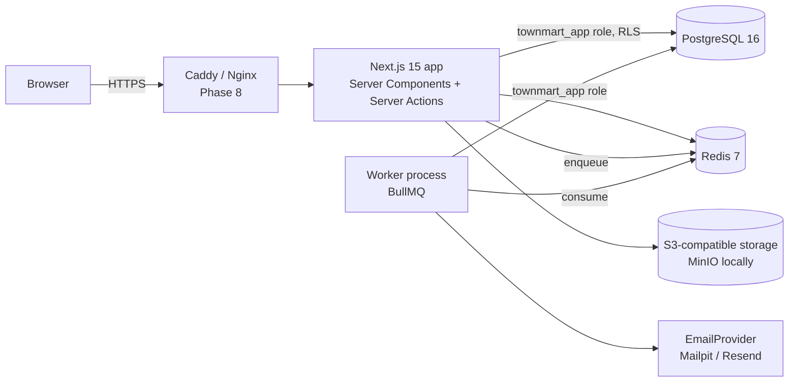

# TownMart architecture

This describes the system as of **Phase 0**. Each phase updates it.

## Runtime view



- **Web app** (`app/`, `lib/`): renders pages and runs Server Actions. Connects to Postgres as `townmart_app`, which cannot bypass row-level security.
- **Worker** (`worker/`): a separate Node process consuming BullMQ queues in Redis. Phase 0 ships the `notifications` queue (email) and `maintenance` jobs (purge expired sessions and tokens), each recorded in `job_runs`.
- **Redis**: rate limiting, BullMQ queues; later stock locks and idempotency keys.
- **Object storage**: MinIO in development with a public bucket (images) and a private, encrypted bucket (KYC, exports). The `StorageProvider` interface arrives with image uploads in Phase 1.

## Request path for a mutation

```mermaid
sequenceDiagram
  participant C as Client form (RHF + Zod)
  participant A as Server Action
  participant Z as authz.can()
  participant DB as Postgres (RLS)
  C->>A: input (validated on client)
  A->>A: Zod parse again (never trust the client)
  A->>A: rate limit (Redis)
  A->>Z: can(user, permission, resource)
  Z-->>A: allowed / AuthzError
  A->>DB: withRls({ userId, scope }) → BEGIN; set_config(...); queries; COMMIT
  DB-->>A: rows filtered by RLS policies
  A->>DB: writeAudit() in the same transaction
```

## Authentication

- **Auth.js v5** with the Prisma adapter and **database sessions** (`sessions` table), so any session can be revoked ("sign out everywhere", password reset).
- **Email + password** is a TownMart Server Action (`lib/auth/actions.ts`), because Auth.js's Credentials provider only supports JWT sessions. It writes to the same `sessions` table and cookie that Auth.js reads, so `auth()` works for every sign-in method.
- Passwords: Argon2id (19 MiB, t=2, p=1). Dummy verification when an email doesn't exist so timing doesn't reveal accounts.
- Lockout after 5 failures for 15 minutes; Redis rate limits per IP and per email on sign-in, sign-up and password reset; Cloudflare Turnstile on sign-up and forgot-password.
- Email verification and password-reset tokens are random 256-bit values, stored as SHA-256 hashes, single use, short-lived. Verification needs an explicit click so link scanners can't consume it.
- Google OAuth is enabled when `AUTH_GOOGLE_ID`/`AUTH_GOOGLE_SECRET` are set. Automatic linking to an existing password account is disabled to prevent account pre-hijacking.

## Authorisation (two layers)

1. **Application** — `lib/authz` maps roles to permissions. Owned permissions (e.g. `address.read`) also check the resource owner; `:any` grants let admins skip that. Layouts render a 403 view; pages call `requirePermission()` as well, because App Router pages can be requested without their layout re-running.
2. **Database** — `withRls()` sets `app.current_user_id`, `app.current_business_id` and `app.current_scope` (`user` | `admin` | `system`) with `set_config(..., true)`, which is transaction-local and therefore safe behind PgBouncer in transaction mode. Policies read them through `app_current_user_id()` etc. See [DATABASE.md](DATABASE.md).

## Phase 0 data model


## Design system

Tokens live in `app/globals.css` as CSS variables (light and dark via `prefers-color-scheme`) and are exposed to Tailwind v4 through `@theme`. Components in `components/ui` use semantic tokens only (`bg-primary`, `text-muted-foreground`). Admins can see everything at `/design-system`.
