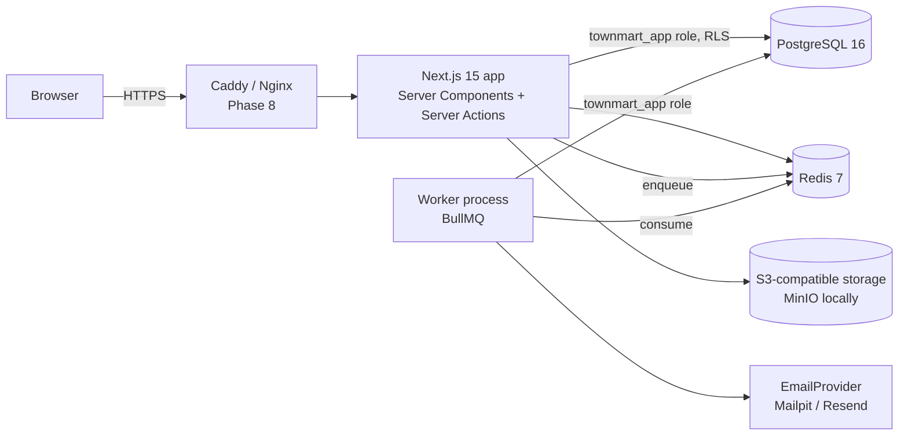
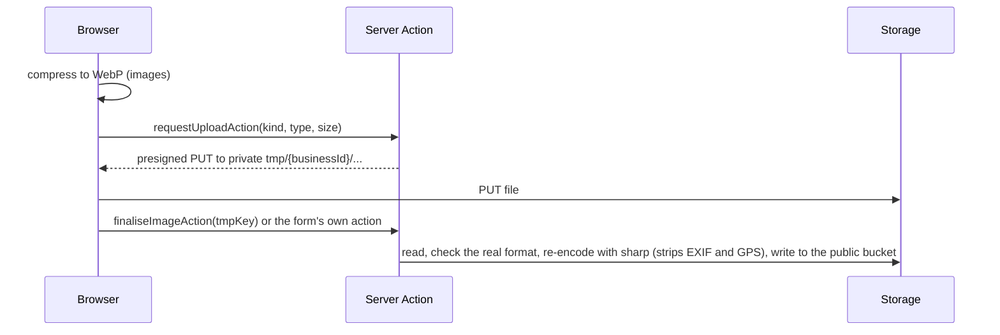

# TownMart architecture

This describes the system as of **Phase 1**. Each phase updates it.

## Runtime view



- **Web app** (`app/`, `lib/`): renders pages and runs Server Actions. Connects to Postgres as `townmart_app`, which cannot bypass row-level security.
- **Worker** (`worker/`): a separate Node process consuming BullMQ queues in Redis. Queues: `notifications` (email, SMS, low-stock alerts), `imports` (product CSV) and `maintenance` (purge expired sessions and tokens), each run recorded in `job_runs`.
- **Redis**: rate limiting, BullMQ queues; later stock locks and idempotency keys.
- **Object storage**: `StorageProvider` (`lib/storage`) over S3/MinIO, or local files in development. A public bucket holds listing and store images; a private, encrypted bucket holds KYC documents, CSV imports and upload staging (`tmp/`).

## Request path for a mutation

```mermaid
sequenceDiagram
  participant C as Client form (RHF + Zod)
  participant A as Server Action
  participant Z as authz.can()
  participant DB as Postgres (RLS)
  C->>A: input (validated on client)
  A->>A: Zod parse again (never trust the client)
  A->>A: rate limit (Redis)
  A->>Z: can(user, permission, resource)
  Z-->>A: allowed / AuthzError
  A->>DB: withRls({ userId, scope }) → BEGIN; set_config(...); queries; COMMIT
  DB-->>A: rows filtered by RLS policies
  A->>DB: writeAudit() in the same transaction
```

## Authentication

- **Auth.js v5** with the Prisma adapter and **database sessions** (`sessions` table), so any session can be revoked ("sign out everywhere", password reset).
- **Email + password** is a TownMart Server Action (`lib/auth/actions.ts`), because Auth.js's Credentials provider only supports JWT sessions. It writes to the same `sessions` table and cookie that Auth.js reads, so `auth()` works for every sign-in method.
- Passwords: Argon2id (19 MiB, t=2, p=1). Dummy verification when an email doesn't exist so timing doesn't reveal accounts.
- Lockout after 5 failures for 15 minutes; Redis rate limits per IP and per email on sign-in, sign-up and password reset; Cloudflare Turnstile on sign-up and forgot-password.
- Email verification and password-reset tokens are random 256-bit values, stored as SHA-256 hashes, single use, short-lived. Verification needs an explicit click so link scanners can't consume it.
- Google OAuth is enabled when `AUTH_GOOGLE_ID`/`AUTH_GOOGLE_SECRET` are set. Automatic linking to an existing password account is disabled to prevent account pre-hijacking.

## Authorisation (two layers)

1. **Application** — `lib/authz` maps roles to permissions. Owned permissions (e.g. `address.read`) also check the resource owner; `:any` grants let admins skip that. Layouts render a 403 view; pages call `requirePermission()` as well, because App Router pages can be requested without their layout re-running.
2. **Database** — `withRls()` sets `app.current_user_id`, `app.current_business_id` and `app.current_scope` (`user` | `admin` | `system`) with `set_config(..., true)`, which is transaction-local and therefore safe behind PgBouncer in transaction mode. Policies read them through `app_current_user_id()` etc. See [DATABASE.md](DATABASE.md).

## Phase 0 data model


## Phase 1: sellers, catalogue and search

### Seller onboarding and approval

`/sell/onboarding` walks a signed-in customer through six saved steps: business details, phone verification (SMS code), identity documents (private bucket), payout account (name resolved with the bank through Paystack), branding, and agreements. Submitting moves the business from `draft` (or `rejected`) to `pending`. Admins work the queue at `/admin/sellers`: start review, mark ID verified or failed, approve, request changes, suspend or reinstate. Approval needs verified ID, a verified payout account and a verified phone; each decision is audited and emailed. KYC documents open through `/api/admin/kyc/...`, which audits the view and redirects to a 60-second signed URL.

Sellers can't skip this: Postgres triggers (`guard_business_status`, `guard_kyc_status`) reject any status, review, rating or KYC-verification change unless the RLS scope is `admin` or `system`.

### Uploads



KYC documents and CSV files are moved out of `tmp/` by the action that uses them. Nothing the browser uploads is served before the server has checked it.

### Catalogue

- **Products** have up to three options (Size, Colour…) and a variant per combination, each with its own SKU (unique per business), price, stock and low-stock threshold, and optionally its own image. Units are piece, kg, litre, crate, bag and pack; fractional quantities are allowed per product.
- **Stock** changes only through `adjustStock()`, which updates the variant and appends a `stock_movements` row in one statement pair; the app role can't update or delete movements. Crossing a threshold queues one low-stock email per variant per day.
- **Services** have pricing models (fixed, from, hourly, packages), packages, weekly availability, blackout dates, service LGAs or a radius, deposit and confirmation settings.
- **CSV import** (one row per variant, grouped by `handle`, matched by SKU) runs in the worker with one transaction per product and a downloadable report. Export uses the same format, so a file can round-trip.
- Seller rich text (Tiptap) is sanitised on the server with DOMPurify before it is stored.

### Search

Pages call `searchProvider().search(query)` only (`lib/search/provider.ts`), so Postgres can later be swapped for Meilisearch or Typesense. The Postgres implementation combines `websearch_to_tsquery` on trigger-maintained `search_vector` columns with trigram similarity for typos, and filters by kind, category (with children), price, rating, state/LGA, store and stock. It runs as a guest under RLS and also filters on live, approved listings explicitly.

### Storefront

`/search`, `/c/[category]`, `/c/[category]/[sub]`, `/p/[slug]` (with Product JSON-LD), `/s/[slug]`, `/store/[slug]`, `/legal/[slug]` and a dynamic `sitemap.xml`. Add to cart and booking buttons say they arrive in the next releases.

## Phase 2: promotions and pricing

### Promotions

A seller creates promotions at `/dashboard/promotions` (permission `promotion.manage`, staff flag `promotions`). Each has a discount (whole percent 1 to 100, or naira off each item), a scope (whole store, one product, selected products, categories, or selected services), a start and end in Lagos time, optional total and per-customer limits, an optional minimum order, and an optional coupon code. Flash deals run for at most 72 hours and appear on the home page and `/deals`. Sellers can pause, resume or end a promotion, and delete one that nobody has used. The edit page shows orders, total discount given, unique customers and what it covers.

Platform-wide promotions (`business_id` NULL) are supported by the schema and pricing engine and are writable only with admin/system scope; their admin screens arrive with the admin console in Phase 7.

### Pricing engine

`lib/pricing` is pure (no database, no clock: `now` is passed in) and is the only place discounts are worked out. All amounts are BigInt kobo.

- **One discount per line.** Each item gets the single best automatic promotion it qualifies for. Ties go to the bigger discount, then the earliest end, then the id, so results are stable.
- **Coupons** replace the automatic discount if they are better, or, if the seller allowed stacking, come off the already-discounted price.
- **Minimum order** is checked against that seller's own items in the cart before discounts (the whole cart for platform promotions).
- Percentages round half-up to the kobo; a fixed amount is taken off each unit; no price goes below ₦0.
- `listingPrice()` is what cards and listing pages show: automatic promotions only (no coupon, no minimum order). `priceCart()` is what checkout uses, returning per-line discounts, coupon status and the redemptions to record.

`lib/promotions/live.ts` loads the live rules for the businesses on a page (as a guest, under RLS) and turns them into a `ListingDeal` for each card. The search "On promotion" filter and the flash-deals section use an SQL predicate (`onPromotionSql`) that mirrors the same rules. Search price filters and sorting still use the undiscounted price.

### Honest pricing

Listings show the real end date of every deal and never a fake countdown. Product JSON-LD uses the price a shopper actually pays today. The rules are written up for shoppers in the draft Promotions & Coupon Terms (`/legal/promotions`).

## Phase 3: cart, checkout and payments

### Cart

Guests get a cart tied to an `HttpOnly` cookie (`tm_cart`, a random token; only its keyed hash is stored, 30 days). Signing in merges the guest cart into the account cart (the larger quantity wins). The cart is grouped by seller, re-priced and re-checked for stock every time it opens, and supports saved-for-later and one coupon. RLS lets a request see only its own cart (`app.current_cart_id` for guests).

### Checkout

`lib/checkout/compute.ts` loads everything (cart, live promotions, zones and rates, commission rules, settings) and `lib/checkout/quote.ts` does all the arithmetic, pure and in BigInt kobo:

- **Delivery** (`lib/checkout/delivery.ts`): the address's zone (a zone naming the LGA beats one naming the state, then the lowest priority), the weight band, and free delivery over a threshold. A seller with its own rates for a zone replaces TownMart's defaults for it. Each seller ships separately; a seller can also offer pickup.
- **Service fee** 1% of goods after discounts, capped at ₦1,000; **VAT** 7.5% of the service fee only (settings `fees.*`).
- **Commission** per line: business rule, then category, then parent category, then global (5% seeded), then the default. It is charged on what the seller is paid for, so a TownMart-funded discount doesn't cost the seller.

The page shows subtotal, discounts, delivery per seller, service fee and VAT before payment. The shopper must tick the Terms of Use and Refund Policy box (the versions are stored on the order); marketing consent is a separate box, unticked by default.

### Placing an order

`placeOrder()` runs in one database transaction in the system scope:

1. Recompute everything from the database and refuse if the total differs from what the shopper saw (`expectedTotalKobo`).
2. Lock the promotions being used (`FOR UPDATE`) and re-check usage limits.
3. Create the order (number `TM-YYYY-NNNNNN` from a sequence), one `seller_order` per seller and the items, with price snapshots.
4. Take the stock now through `adjustStock()` (a `reservation` movement). The variant's row lock serialises concurrent buyers and stock can't go below zero, so it can't be oversold; variants are locked in id order to avoid deadlocks. A test races 50 buyers for 10 units and exactly 10 orders succeed.
5. Online payment: the stock is held for 15 minutes (`checkout.stock_hold_minutes`). Pay on delivery (when the global switch is on and every seller in the order accepts it) is confirmed straight away.

### Payments

`lib/payments` has one `PaymentProvider` interface with Paystack, Flutterwave (amounts converted from naira at the edge) and a development-only fake provider (`/checkout/pay/fake`, refused in production). If the primary provider can't start a payment, the fallback (`PAYMENT_FALLBACK_PROVIDER`) is tried. Each attempt is a `payments` row with its own reference.

A payment is only ever confirmed by calling the provider's **verify** API, never from a webhook body or the browser redirect. `applyVerifiedPayment()` locks the order, checks the amount and currency exactly, marks it paid, converts the stock holds, records promotion redemptions and posts the ledger, all in one transaction, and is idempotent. The shopper's return from the payment page, webhooks and the expiry job can all call it safely.

Webhooks (`/api/webhooks/{paystack|flutterwave}`) check the signature (Paystack HMAC-SHA512, Flutterwave `verif-hash`), store every delivery in `payment_events` (unique per provider and event id, so replays are acknowledged and ignored) and hand valid ones to the worker, which verifies with the provider.

The `orders.expire-unpaid` job runs every minute: it asks the provider about any unpaid order past its hold (in case a webhook is late), otherwise cancels it and puts the stock back. A payment that arrives after expiry takes the stock again if it can; if not, or if the amount is wrong or the order was already paid, the order is logged as needing attention for a refund (Phase 5).

### Ledger

Double-entry, BigInt kobo, append-only (`ledger_accounts`, `ledger_transactions`, `ledger_entries`). For a captured payment:

| Account | Debit | Credit |
|---|---|---|
| Provider clearing | total paid | |
| Platform promotions | discounts TownMart funds | |
| Each seller's escrow | | the seller's net (goods − own discounts + delivery − commission) |
| Platform commission, fees, tax | | commission, service fee, VAT |

`lib/ledger/entries.ts` builds balanced postings; a deferred constraint trigger also rejects any transaction whose debits and credits differ when it commits. Each transaction is unique per (kind, reference), so a retry can't post twice. Escrow is released to sellers in Phase 5.

### After the order

The worker's `order.confirmed` job sends the itemised receipt (email and SMS), an email and in-app notification to each seller, and low-stock alerts, once per order. Shoppers see their orders, saved addresses, payment attempts and notifications under `/account`; guests open their order from the link in the receipt (a token derived from the order id; only its hash is stored). Sellers see their part of recent orders on the dashboard; full order management is Phase 4.

## Design system

Tokens live in `app/globals.css` as CSS variables (light and dark via `prefers-color-scheme`) and are exposed to Tailwind v4 through `@theme`. Components in `components/ui` use semantic tokens only (`bg-primary`, `text-muted-foreground`). Admins can see everything at `/design-system`.
