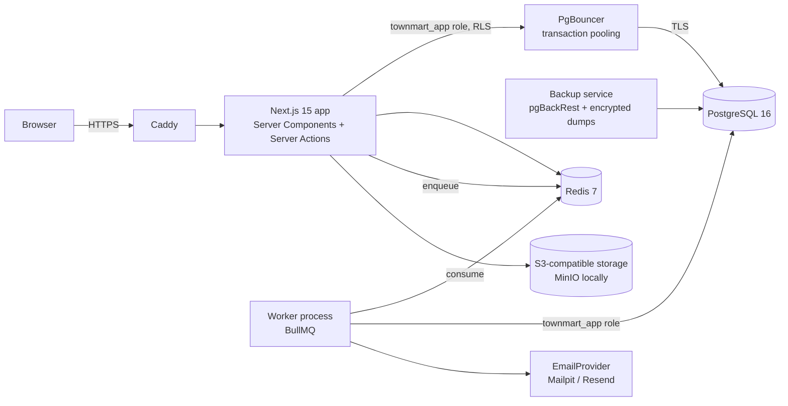
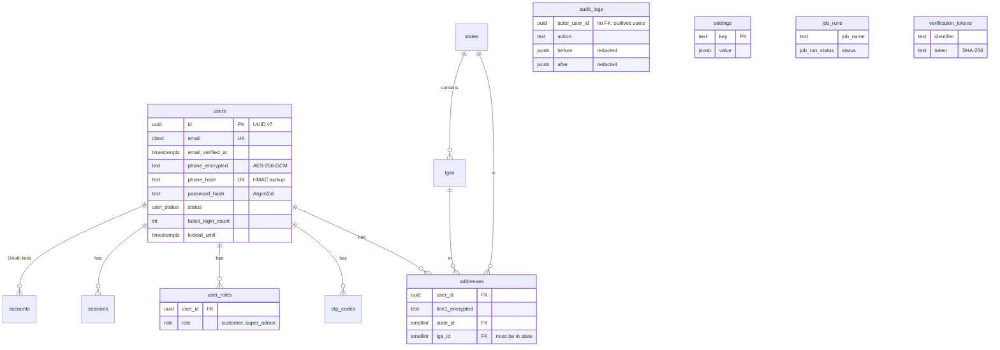
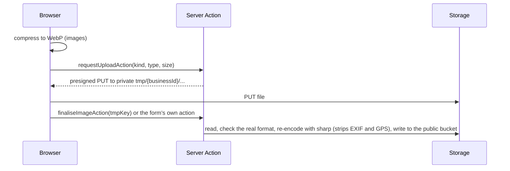

# TownMart architecture

This describes the system as of **Phase 1**. Each phase updates it.

## Runtime view



- **Web app** (`app/`, `lib/`): renders pages and runs Server Actions. Connects to Postgres as `townmart_app`, which cannot bypass row-level security.
- **Worker** (`worker/`): a separate Node process consuming BullMQ queues in Redis. Queues: `notifications` (email, SMS, low-stock alerts), `imports` (product CSV) and `maintenance` (purge expired sessions and tokens), each run recorded in `job_runs`.
- **Redis**: rate limiting, BullMQ queues; later stock locks and idempotency keys.
- **Object storage**: `StorageProvider` (`lib/storage`) over S3/MinIO, or local files in development. A public bucket holds listing and store images; a private, encrypted bucket holds KYC documents, CSV imports and upload staging (`tmp/`).

## Request path for a mutation

```mermaid
sequenceDiagram
  participant C as Client form (RHF + Zod)
  participant A as Server Action
  participant Z as authz.can()
  participant DB as Postgres (RLS)
  C->>A: input (validated on client)
  A->>A: Zod parse again (never trust the client)
  A->>A: rate limit (Redis)
  A->>Z: can(user, permission, resource)
  Z-->>A: allowed / AuthzError
  A->>DB: withRls({ userId, scope }) → BEGIN; set_config(...); queries; COMMIT
  DB-->>A: rows filtered by RLS policies
  A->>DB: writeAudit() in the same transaction
```

## Authentication

- **Auth.js v5** with the Prisma adapter and **database sessions** (`sessions` table), so any session can be revoked ("sign out everywhere", password reset).
- **Email + password** is a TownMart Server Action (`lib/auth/actions.ts`), because Auth.js's Credentials provider only supports JWT sessions. It writes to the same `sessions` table and cookie that Auth.js reads, so `auth()` works for every sign-in method.
- Passwords: Argon2id (19 MiB, t=2, p=1). Dummy verification when an email doesn't exist so timing doesn't reveal accounts.
- Lockout after 5 failures for 15 minutes; Redis rate limits per IP and per email on sign-in, sign-up and password reset; Cloudflare Turnstile on sign-up and forgot-password.
- Email verification and password-reset tokens are random 256-bit values, stored as SHA-256 hashes, single use, short-lived. Verification needs an explicit click so link scanners can't consume it.
- Google OAuth is enabled when `AUTH_GOOGLE_ID`/`AUTH_GOOGLE_SECRET` are set. Automatic linking to an existing password account is disabled to prevent account pre-hijacking.

## Authorisation (two layers)

1. **Application** — `lib/authz` maps roles to permissions. Owned permissions (e.g. `address.read`) also check the resource owner; `:any` grants let admins skip that. Layouts render a 403 view; pages call `requirePermission()` as well, because App Router pages can be requested without their layout re-running.
2. **Database** — `withRls()` sets `app.current_user_id`, `app.current_business_id` and `app.current_scope` (`user` | `admin` | `system`) with `set_config(..., true)`, which is transaction-local and therefore safe behind PgBouncer in transaction mode. Policies read them through `app_current_user_id()` etc. See [DATABASE.md](DATABASE.md).

## Phase 0 data model



## Phase 1: sellers, catalogue and search

### Seller onboarding and approval

`/sell/onboarding` walks a signed-in customer through six saved steps: business details, phone verification (SMS code), identity documents (private bucket), payout account (name resolved with the bank through Paystack), branding, and agreements. Submitting moves the business from `draft` (or `rejected`) to `pending`. Admins work the queue at `/admin/sellers`: start review, mark ID verified or failed, approve, request changes, suspend or reinstate. Approval needs verified ID, a verified payout account and a verified phone; each decision is audited and emailed. KYC documents open through `/api/admin/kyc/...`, which audits the view and redirects to a 60-second signed URL.

Sellers can't skip this: Postgres triggers (`guard_business_status`, `guard_kyc_status`) reject any status, review, rating or KYC-verification change unless the RLS scope is `admin` or `system`.

### Uploads



KYC documents and CSV files are moved out of `tmp/` by the action that uses them. Nothing the browser uploads is served before the server has checked it.

### Catalogue

- **Products** have up to three options (Size, Colour…) and a variant per combination, each with its own SKU (unique per business), price, stock and low-stock threshold, and optionally its own image. Units are piece, kg, litre, crate, bag and pack; fractional quantities are allowed per product.
- **Stock** changes only through `adjustStock()`, which updates the variant and appends a `stock_movements` row in one statement pair; the app role can't update or delete movements. Crossing a threshold queues one low-stock email per variant per day.
- **Services** have pricing models (fixed, from, hourly, packages), packages, weekly availability, blackout dates, service LGAs or a radius, deposit and confirmation settings.
- **CSV import** (one row per variant, grouped by `handle`, matched by SKU) runs in the worker with one transaction per product and a downloadable report. Export uses the same format, so a file can round-trip.
- Seller rich text (Tiptap) is sanitised on the server with DOMPurify before it is stored.

### Search

Pages call `searchProvider().search(query)` only (`lib/search/provider.ts`), so Postgres can later be swapped for Meilisearch or Typesense. The Postgres implementation combines `websearch_to_tsquery` on trigger-maintained `search_vector` columns with trigram similarity for typos, and filters by kind, category (with children), price, rating, state/LGA, store and stock. It runs as a guest under RLS and also filters on live, approved listings explicitly.

### Storefront

`/search`, `/c/[category]`, `/c/[category]/[sub]`, `/p/[slug]` (with Product JSON-LD), `/s/[slug]`, `/store/[slug]`, `/legal/[slug]` and a dynamic `sitemap.xml`. Add to cart and booking buttons say they arrive in the next releases.

## Phase 2: promotions and pricing

### Promotions

A seller creates promotions at `/dashboard/promotions` (permission `promotion.manage`, staff flag `promotions`). Each has a discount (whole percent 1 to 100, or naira off each item), a scope (whole store, one product, selected products, categories, or selected services), a start and end in Lagos time, optional total and per-customer limits, an optional minimum order, and an optional coupon code. Flash deals run for at most 72 hours and appear on the home page and `/deals`. Sellers can pause, resume or end a promotion, and delete one that nobody has used. The edit page shows orders, total discount given, unique customers and what it covers.

Platform-wide promotions (`business_id` NULL) are supported by the schema and pricing engine and are writable only with admin/system scope; their admin screens arrive with the admin console in Phase 7.

### Pricing engine

`lib/pricing` is pure (no database, no clock: `now` is passed in) and is the only place discounts are worked out. All amounts are BigInt kobo.

- **One discount per line.** Each item gets the single best automatic promotion it qualifies for. Ties go to the bigger discount, then the earliest end, then the id, so results are stable.
- **Coupons** replace the automatic discount if they are better, or, if the seller allowed stacking, come off the already-discounted price.
- **Minimum order** is checked against that seller's own items in the cart before discounts (the whole cart for platform promotions).
- Percentages round half-up to the kobo; a fixed amount is taken off each unit; no price goes below ₦0.
- `listingPrice()` is what cards and listing pages show: automatic promotions only (no coupon, no minimum order). `priceCart()` is what checkout uses, returning per-line discounts, coupon status and the redemptions to record.

`lib/promotions/live.ts` loads the live rules for the businesses on a page (as a guest, under RLS) and turns them into a `ListingDeal` for each card. The search "On promotion" filter and the flash-deals section use an SQL predicate (`onPromotionSql`) that mirrors the same rules. Search price filters and sorting still use the undiscounted price.

### Honest pricing

Listings show the real end date of every deal and never a fake countdown. Product JSON-LD uses the price a shopper actually pays today. The rules are written up for shoppers in the draft Promotions & Coupon Terms (`/legal/promotions`).

## Phase 3: cart, checkout and payments

### Cart

Guests get a cart tied to an `HttpOnly` cookie (`tm_cart`, a random token; only its keyed hash is stored, 30 days). Signing in merges the guest cart into the account cart (the larger quantity wins). The cart is grouped by seller, re-priced and re-checked for stock every time it opens, and supports saved-for-later and one coupon. RLS lets a request see only its own cart (`app.current_cart_id` for guests).

### Checkout

`lib/checkout/compute.ts` loads everything (cart, live promotions, zones and rates, commission rules, settings) and `lib/checkout/quote.ts` does all the arithmetic, pure and in BigInt kobo:

- **Delivery** (`lib/checkout/delivery.ts`): the address's zone (a zone naming the LGA beats one naming the state, then the lowest priority), the weight band, and free delivery over a threshold. A seller with its own rates for a zone replaces TownMart's defaults for it. Each seller ships separately; a seller can also offer pickup.
- **Service fee** 1% of goods after discounts, capped at ₦1,000; **VAT** 7.5% of the service fee only (settings `fees.*`).
- **Commission** per line: business rule, then category, then parent category, then global (5% seeded), then the default. It is charged on what the seller is paid for, so a TownMart-funded discount doesn't cost the seller.

The page shows subtotal, discounts, delivery per seller, service fee and VAT before payment. The shopper must tick the Terms of Use and Refund Policy box (the versions are stored on the order); marketing consent is a separate box, unticked by default.

### Placing an order

`placeOrder()` runs in one database transaction in the system scope:

1. Recompute everything from the database and refuse if the total differs from what the shopper saw (`expectedTotalKobo`).
2. Lock the promotions being used (`FOR UPDATE`) and re-check usage limits.
3. Create the order (number `TM-YYYY-NNNNNN` from a sequence), one `seller_order` per seller and the items, with price snapshots.
4. Take the stock now through `adjustStock()` (a `reservation` movement). The variant's row lock serialises concurrent buyers and stock can't go below zero, so it can't be oversold; variants are locked in id order to avoid deadlocks. A test races 50 buyers for 10 units and exactly 10 orders succeed.
5. Online payment: the stock is held for 15 minutes (`checkout.stock_hold_minutes`). Pay on delivery (when the global switch is on and every seller in the order accepts it) is confirmed straight away.

### Payments

`lib/payments` has one `PaymentProvider` interface with Paystack, Flutterwave (amounts converted from naira at the edge) and a development-only fake provider (`/checkout/pay/fake`, refused in production). If the primary provider can't start a payment, the fallback (`PAYMENT_FALLBACK_PROVIDER`) is tried. Each attempt is a `payments` row with its own reference.

A payment is only ever confirmed by calling the provider's **verify** API, never from a webhook body or the browser redirect. `applyVerifiedPayment()` locks the order, checks the amount and currency exactly, marks it paid, converts the stock holds, records promotion redemptions and posts the ledger, all in one transaction, and is idempotent. The shopper's return from the payment page, webhooks and the expiry job can all call it safely.

Webhooks (`/api/webhooks/{paystack|flutterwave}`) check the signature (Paystack HMAC-SHA512, Flutterwave `verif-hash`), store every delivery in `payment_events` (unique per provider and event id, so replays are acknowledged and ignored) and hand valid ones to the worker, which verifies with the provider.

The `orders.expire-unpaid` job runs every minute: it asks the provider about any unpaid order past its hold (in case a webhook is late), otherwise cancels it and puts the stock back. A payment that arrives after expiry takes the stock again if it can; if not, or if the amount is wrong or the order was already paid, the payment is refunded automatically (`refundUnappliedPayment`, Phase 5).

### Ledger

Double-entry, BigInt kobo, append-only (`ledger_accounts`, `ledger_transactions`, `ledger_entries`). For a captured payment:

| Account | Debit | Credit |
|---|---|---|
| Provider clearing | total paid | |
| Platform promotions | discounts TownMart funds | |
| Each seller's escrow | | the seller's net (goods − own discounts + delivery − commission) |
| Platform commission, fees, tax | | commission, service fee, VAT |

`lib/ledger/entries.ts` builds balanced postings; a deferred constraint trigger also rejects any transaction whose debits and credits differ when it commits. Each transaction is unique per (kind, reference), so a retry can't post twice. Escrow release, refunds and payouts (Phase 5) add their own transaction kinds.

### After the order

The worker's `order.confirmed` job sends the itemised receipt (email and SMS), an email and in-app notification to each seller, and low-stock alerts, once per order. Shoppers see their orders, saved addresses, payment attempts and notifications under `/account`; guests open their order from the link in the receipt (a token derived from the order id; only its hash is stored). Sellers manage their part of each order from `/dashboard/orders` (Phase 4).

## Phase 4: fulfilment, bookings and reviews

### Orders after payment

Each seller handles its own `seller_order`. The steps are fixed (`lib/fulfilment/orders.ts`): paid → processing → shipped (with optional tracking) or ready for pickup → delivered. The seller takes these steps under its own RLS; the `guard_seller_order_status` trigger allows exactly these moves for a seller, and column grants stop it touching money columns. Pay-on-delivery orders start at processing; the seller records "I've been paid" when the cash is handed over and can cancel before sending. Completing an order (the customer's "I received it", or the `orders.auto-complete` job `orders.auto_complete_days` after delivery, 7 by default) runs in the system scope and starts the escrow countdown. A booking-only seller order completes when its last booking ends.

Sellers get an order list with filters, an order page (items, customer contact, history, messages, next step) and a printable packing slip (`/print/packing-slip/[id]`). The customer's phone number is hidden from the seller 30 days after completion. Customers see one merged timeline per seller on their order page and can confirm receipt.

### Bookings

A service line in the cart carries a start time. The slot engine (`lib/bookings/slots.ts`, pure) lays the provider's weekly hours on a grid in Lagos time, removes blackouts, the lead time and full slots, and counts places left (`max_per_slot`). `placeOrder()` claims each booking with `claimSlot()`: a per-service advisory lock, a re-check of the grid, then the first free place number. The `bookings_no_overlap` exclusion constraint on `(service_id, slot_no, tstzrange)` is the final word, so a slot can't be oversold even by code that skips the checks; a test races 8 shoppers for a 2-place slot.

Deposits: a service can ask for part of the price online (`deposit_percent`); the rest is recorded as `pay_later` on the booking, the seller order and the order, and is paid to the provider on the day. The order total, payment and ledger exclude it (the seller's escrow credit is its net minus the balance it collects itself).

Statuses: held (waiting for online payment) → requested (if the provider confirms bookings) or confirmed → in progress → completed, or cancelled / no-show. The provider confirms, starts and completes under its own RLS (`guard_booking_status`). Cancelling and moving run in the system scope after an authz check: customers can cancel or move before the start time (a move goes back to "requested" if the provider confirms bookings), providers can decline, cancel or move. A move updates the booking in place and keeps `previous_starts_at`; `guard_booking_time` stops anything but TownMart code changing the time. Every change is in `booking_status_history`.

### Messages and notices

Each seller order has one conversation between the customer and the seller (`messages`, append-only apart from `read_at`). Order steps, booking changes and new messages queue a `fulfilment.notice` job; the worker tells the other side by email, in-app notification and, for steps that matter on the day, SMS. Job ids de-duplicate retries. The `bookings.reminders` job (every 5 minutes) reminds both sides 24 hours and 1 hour before a confirmed booking, claiming each reminder by setting its `reminder_*_sent_at` column first. The header bell shows unread in-app notifications.

### Reviews

Only a verified buyer can review (`findReviewable`): the account that placed the order, once per item, after the goods were delivered or the booking was completed, on an order that wasn't cancelled. Reviews have a rating, text and up to 4 photos (uploaded to `reviews/u-<user id>/`, and only the reviewer's own uploads are accepted), and show the reviewer as "First L.". Writing a review recomputes the product, service and store ratings (`refresh_ratings`, system scope). The seller can reply publicly; anyone signed in can report a review, which marks it for moderation (Phase 7). Hidden reviews are visible only to their author, the seller and TownMart.

### Seller tools

`/dashboard` shows today's sales, orders to handle, bookings this week, payout balance (from the ledger), rating, a 14-day earnings chart and top products. `/dashboard/bookings` is a day-by-day diary with the booking actions, `/dashboard/messages` an inbox, `/dashboard/reviews` the review list with replies, and `/dashboard/settings/delivery` lets a seller replace TownMart's default rates for any zone with its own weight bands.

Shoppers get `/account/bookings`, `/account/reviews` (items waiting for a review, and their reviews) and `/account/wishlist` (the Save button on product and service pages).

## Phase 5: refunds, disputes and payouts

### Refunds

A refund (`refunds`, with `refund_items` for the lines it covers) belongs to one seller order, or to a payment only when TownMart returns a payment it couldn't use. It moves requested → approved → processing → completed, or failed; a request can also be rejected. `lib/refunds/core.ts` holds the rules:

- **Who asks.** The customer from `/orders/{number}/help/{seller order}` (signed in, or a guest with the order link): cancel while the seller hasn't started (full refund at once), or ask for a refund or return of some items within the store's return window (fresh produce within 24 hours, with a photo; damaged, wrong or not-as-described items need a photo). The seller can cancel a paid order it can't fulfil (full refund). Cancelling a paid booking refunds it under the policy: all of it if the provider cancels or the customer cancels 24 hours or more before the start, `refunds.late_cancel_percent` (50%) after that. TownMart can refund any seller order from the admin console. One request can be open per seller order (a unique partial index).
- **Who decides.** The seller approves (all, or less than asked, choosing what goes back on sale) or declines with a reason, by `refunds.seller_response_hours` (48). The `refunds.escalate` job hands overdue requests to TownMart as a dispute. Approval fixes the money split and writes the ledger in the same transaction; restocking and order status follow (a full refund cancels a seller order that hasn't been handed over, or marks it refunded).
- **The money split.** The refund amount comes back from the seller's share; TownMart returns the commission and any TownMart-funded discount in proportion, so the seller loses only what they received for those items. The service fee and VAT are refunded with the refund that empties the whole order. Before escrow is released the seller's part is taken from escrow, afterwards from their available balance.
- **Paying it back.** After approval, `sendRefund()` claims the refund (processing) and calls the provider outside any transaction, keyed by the refund number; the `refunds.process` job (every 2 minutes) retries anything left behind and checks pending provider refunds. A provider refusal marks it failed; TownMart sees failed refunds on `/admin/payouts` and can send them again. Provider `refund.*` webhooks are verified the same way as payments. Completion posts `refund_paid` and sets the order's payment status to refunded or partially refunded.

Pay-on-delivery orders can't be refunded through TownMart (the seller holds the cash), but they can be disputed.

### Disputes

The customer asks TownMart to decide (`disputes`, `dispute_messages`), after a declined refund or about anything else on a seller order; an overdue refund request becomes one automatically. One open dispute per seller order. The customer, the seller and TownMart write in one thread (append-only); the customer can withdraw. An admin decides on `/admin/disputes/[id]`: full refund of what's left, a part refund or no refund, with a note both sides see. A refund decision creates and approves the refund in the same transaction. Every admin decision is in the audit log.

### Escrow and payouts

A seller's share of an online payment is held in escrow until delivery plus `escrow_release_days` (3), then the `escrow.release` job (every 15 minutes) moves what's left of it to the seller's available balance (`escrow_released`). Nothing is released while a refund request or dispute on that order is open. For pay-on-delivery orders the same job, once the cash is collected and the period has passed, takes TownMart's commission, service fee and VAT share from the seller's available balance (`pod_settled`).

`payouts.run` (weekdays 10:00 Lagos) pays each approved seller with a verified bank account its whole available balance once it reaches `payouts.minimum_naira` (₦1,000); the owner can also pay out now from `/dashboard/payouts`. One payout per business can be in flight (unique partial index plus an advisory lock). The ledger moves the money to provider clearing when the payout is created; the transfer is sent afterwards with our reference as the idempotency key, asking the provider about that reference first so a retry never pays twice. `payouts.sync` follows transfers in progress and `transfer.*` webhooks; a failed transfer reverses the posting, so the money is back in the seller's balance. Payouts use Paystack transfers to the recipient registered when the seller's bank account was verified (`BANK_VERIFIER=fake` in development).

Ledger postings added in this phase (all in `lib/ledger/entries.ts`, balanced and unique per kind and reference):

| Kind | Reference | Debit | Credit |
|---|---|---|---|
| `escrow_released` | seller order | seller escrow | seller available |
| `pod_settled` | seller order | seller available; platform promotions (TownMart-funded discounts) | commission, fees, tax |
| `refund_approved` | refund | seller escrow or available; commission; fees; tax | platform promotions; platform refunds |
| `refund_paid` | refund | platform refunds | provider clearing |
| `payment_unapplied` | refund | provider clearing | platform refunds |
| `payout` / `payout_returned` | payout | seller available / transfer clearing | transfer clearing / seller available |

### Statements and money screens

`/dashboard/payouts` (owner only) shows the available and held balances, the next release, this month's sales, commission, refunds and payouts, the bank account, a pay-out-now button and the payout history. Monthly statements are built from the ledger in Lagos time (`lib/payouts/statement.ts`): opening and closing balances and every movement, as a printable page or CSV (text cells are guarded against spreadsheet formulas). `/dashboard/refunds` lists requests waiting for the seller (with the deadline), all refunds and disputes. Customers see their refunds at `/account/refunds` and on each order. `/admin/orders` has queues for open disputes, refund requests and failed refunds, plus order search; `/admin/payouts` shows payouts, failed refunds, where the money is (sellers' escrow and balances, TownMart's commission, fees, VAT and refunds owed, provider clearing) with a trial-balance check, and buttons to run the escrow and payout jobs now.

Notices for refunds, disputes and payouts go through the same worker job as order notices (`refund.update`, `dispute.update`, `payout.update`), by email and in-app notification. Photos for refund requests are stored privately under `evidence/o-<order id>/` and opened through `/api/refunds/[id]/evidence/[n]`, which checks the viewer is the customer (or has the order link), the seller or TownMart and redirects to a 60-second signed URL.

## Phase 6: legal, consent and privacy (NDPA 2023)

### Legal pages

Every page under `/legal/*` (13, listed in `lib/legal/documents.ts`, all linked from the footer) is a row in `legal_documents`, versioned by effective date. A page shows the version in force, notes an upcoming one, lists older versions (`?v=` opens one) and, while `is_template` is set, carries the notice "Template: review with a Nigerian lawyer/DPO before launch". The seed writes the starting templates (`prisma/legal-templates.ts`, version `2026-10-draft`). Admins publish a new version on `/admin/compliance/legal/[slug]` with the rich-text editor (sanitised), an effective date and a change note; nothing is ever edited in place. `{{company.*}}` and `{{retention.*}}` placeholders are filled from the company details and retention settings on `/admin/compliance/retention`, and anything not set yet shows as a highlighted "[… not set]" marker.

`recordAcceptances()` writes a `policy_acceptances` row per document at sign-up (Terms, Privacy), checkout (Terms, Refunds; guests by order) and seller onboarding (Seller Agreement, DPA, Prohibited Items, plus Service Provider Terms for service sellers), and returns the versions copied onto the order or business. Google sign-up records the same acceptances in the `createUser` event; the sign-in and sign-up pages say continuing with Google accepts them.

### Cookies and marketing

`<ConsentManager />` in the root layout reads the `tm_consent` cookie (random subject id, three choices, Cookie Policy version, time). Until there is a current choice it shows the banner: Accept all, Reject non-essential and Customise, all the same size and style. Analytics and marketing scripts (`ANALYTICS_SCRIPT_URL`, `MARKETING_SCRIPT_URL`) are rendered only for the categories allowed, so nothing loads before consent. Each choice is stored in `consent_records` (append-only); the banner returns after 12 months or when the Cookie Policy changes. "Cookie settings" in the footer and the Privacy Centre reopen it.

Marketing is opt-in and separate from the terms: a box at sign-up and checkout, and a switch in notification settings. Every marketing email carries `List-Unsubscribe` with one-click POST (RFC 8058, `/api/unsubscribe`) and a footer link to `/unsubscribe`; both are HMAC-signed and need no sign-in. Unsubscribed addresses go on `marketing_suppressions`, and `marketingAudience()` (the only source for a campaign list) leaves them out.

### Privacy Centre and data requests

`/account/privacy` lets a signed-in person: download their data (JSON and PDF, built by the `privacy` worker job, stored privately and offered through a signed link for 7 days); correct their name (other details on the profile pages); change cookie and marketing choices; object to or restrict processing, or ask for anything else, as a request; and delete their account. Deletion signs them out everywhere and starts a 14-day grace period; signing in again (after two-step sign-in, if on) cancels it. When it ends, `retention.anonymise-accounts` removes everything that identifies them (name, email, phone, password, sign-in methods, addresses, carts, wishlist, notifications, roles; reviews show "Former customer"), keeps order, payment and refund records for six years as the law requires, suppresses marketing to the old address and emails it to confirm. Shop owners' deletions are handled by hand.

`/legal/data-request` is the public form for people without an account (Turnstile, rate limited by IP and email). The requester confirms by email link before the request joins the queue; unconfirmed requests are removed after 7 days. Every request (`data_subject_requests`, `DSR-YYYY-NNNNNN`) has a deadline (30 days by default) and its history in the audit log; closing one emails the requester.

### Compliance centre

`/admin/compliance` (`compliance.manage`, admins): an overview of what's due; the request queue with SLA countdown, assignment, notes, linking to an account and preparing an export; the breach register with a live 72-hour NDPC countdown from the moment TownMart became aware, NDPC reference, notice to the people affected and a ready-to-edit notice; the Record of Processing Activities, processors (with DPA dates) and DPIAs; retention periods and company details; legal page publishing; and logs of cookie choices and staff access to personal data. Opening someone's order, dispute or data request in the admin console writes a `personal_data.viewed` audit entry, alongside the existing KYC and application view entries.

### Retention jobs

Nightly (02:10 to 02:55 Lagos), each reading its period from `retention_settings` at run time: abandoned carts (30 days), unverified sign-ups that never did anything (30 days; never staff, shop owners or anyone with an order, booking or review), job logs and in-app notifications (12 months), accounts past their deletion grace period, unconfirmed public requests (7 days) and expired export files. Order, payment, refund and ledger records and the audit log are never touched.

### Account security and notices

Two-step sign-in by SMS code to a verified phone, switched on from `/account/security`: after a correct password the browser gets only a signed 10-minute `tm_2fa` cookie, and the session is created once the code is right. The phone can't be removed while it's on. The same page connects or disconnects Google (an existing account links only from inside it; an account with no password and no verified phone can't disconnect its only way to sign in). `/account/notifications` sets SMS order updates, SMS booking reminders, message emails and marketing; order and booking notices honour them, and emails that are needed for the service (receipts, refunds, security) are always sent.

## Phase 7: admin console and analytics

Every admin page checks a permission from `lib/authz` (`moderation.manage`, `catalogue.manage`, `settings.manage`, `content.manage`, `dispute.manage`, `user.manage`, `user.roles.manage`, `audit_log.read`, `analytics.view`, `system_health.view`, `jobs.retry`) and reads in the admin RLS scope. Admin actions go through `adminContext(permission)` (`lib/admin/context.ts`), which checks the permission, runs the change in the admin scope and hands it an audit writer, so every change lands in `audit_logs` with before and after.

### Dashboard and analytics

`/admin` shows what needs attention: seller applications, reported listings and reviews, open disputes, failed refunds, data requests (and overdue ones), open breaches and jobs that failed in the last day. `/admin/analytics` (`lib/analytics/metrics.ts`) shows GMV, confirmed orders, average order value, refund rate, active sellers and new customers for 7, 30 or 90 days, each compared with the period before, plus a daily chart, top categories and top sellers. Definitions are on the page; days are Lagos days. The daily figures download as CSV (`/api/admin/analytics`, cells guarded against spreadsheet formulas).

### Moderation

Shoppers report a listing (reason and details, one open report per person per listing) and ask questions on product and service pages. Saving a listing checks it against the prohibited-items keyword list (`/admin/moderation/keywords`, stored in `settings`, whole words and simple plurals) and opens a `keyword_match` report on a hit. `/admin/moderation` has queues for reports, questions and reported reviews, and a list of taken-down listings. Taking a listing down needs a reason; the listing leaves the storefront and search at once, the seller is told why and sees "Taken down by TownMart" in their dashboard, can keep editing, and TownMart restores it. Only TownMart can set or clear a take-down (trigger) or hide a question. Reporters' names are never shown to the shop.

Shops answer questions at `/dashboard/questions` (`question.answer`); an answered question shows publicly on the listing.

### Catalogue, fees and delivery

`/admin/catalogue` edits the two-level category tree (a slug can't change once listings use it), attributes (select, number or text) and which attributes each category asks for. Attributes are inherited from the parent category, and a required one must be filled. The product form shows them in a Details card, `saveProduct` validates them (`lib/catalogue/attributes.ts`), CSV imports keep existing values, and the storefront product page shows them. The same section edits commission rules (global, per category or per store, starting now or later), delivery zones and TownMart's default rates, platform-wide promotions (store or category scope) and platform settings (service fee, VAT, default commission, stock hold, pay on delivery, auto-complete, refund deadlines, late-cancellation share, escrow days, payout minimum, booking lead time and horizon), each range-checked.

### Content

`/admin/content` manages homepage banners (image uploaded to `banners/cms/`, link on TownMart or https, optional start and end), featured stores, help-centre answers by section and the about and contact pages. Rich text goes through `sanitizeCmsHtml`, which also allows links to TownMart paths. The public pages are `/help`, `/about` and `/contact`.

### Orders, bookings and disputes

`/admin/orders` (Phase 5) gains `/admin/orders/bookings`: every booking, with views for upcoming, waiting for the provider, today and recent cancellations or no-shows, and search by order, provider, service or customer email. Changes happen on the order page.

### Users, roles and the audit log

`/admin/users` searches accounts by name, email or role. A user's page shows their roles, stores, orders and recent audit entries. Admins can suspend (with a reason; signs them out everywhere), restore or sign someone out. Roles are changed by super admins only (`user.roles.manage`); at least one super admin always remains and nobody removes their own super admin role. `/admin/users/audit` (`audit_log.read`) filters the append-only audit log by actor, action, entity and date and shows before and after.

### System health

`/admin/system` (`lib/system/health.ts`) shows database size and connections, the largest tables, queries running over 5 seconds, the slowest statements (when `pg_stat_statements` is loaded), every BullMQ queue's counts and recent failures with retry buttons (`jobs.retry`), the last run of each scheduled job, and the last backup and restore drill. Each section fails on its own, so a Redis outage shows as "unavailable" rather than breaking the page. Backups and restore drills record themselves into the append-only `ops_events` (Phase 8); `pnpm ops:record backup|restore_test --ok|--failed` records one taken by hand.

### Staff

Store owners invite people by email at `/dashboard/staff` and choose what each can do (products and services, orders, bookings, promotions, reviews and questions). The emailed link (`/invite/[token]`, hashed, 7 days, resendable and revocable) is accepted while signed in with that email; an account that owns or already works for a store can't accept. Owners change permissions or remove staff at any time, and the change applies on the next request.

## Phase 8: hardening and operations

### Production stack

`docker-compose.prod.yml` puts only Caddy on the internet. The app and worker reach Postgres through PgBouncer in transaction mode over TLS; that is safe because every advisory lock is transaction-scoped and `withRls()` sets its settings with `set_config(…, true)`, so nothing outlives a transaction (all database tests also pass through PgBouncer). Postgres accepts TCP only over TLS, loads `pg_stat_statements` and archives WAL with pgBackRest. App containers get blanked superuser and migrator passwords; migrations run in a one-off `migrate` container as the schema owner. Step by step: DEPLOYMENT.md.

### Backups

The `backup` service (`scripts/db/scheduler.sh`) runs pgBackRest backups (point-in-time recovery, WAL every minute), a nightly `pg_dump` of one consistent snapshot encrypted with age (`backup.sh`), copies both to a second location, and a monthly restore drill (`verify-restore.sh`) that restores the newest dump into a scratch database and compares every table's row count with counts taken in the dump's own snapshot. Runbooks: DATABASE.md.

### Content-Security-Policy

`middleware.ts` makes a fresh nonce for every page request and sets a strict policy built by `lib/security/csp.ts`: scripts need the nonce (plus `'strict-dynamic'` for what they load), and only the configured storage, Turnstile, payment pages and consent-gated analytics are allowed. Next.js reads the nonce from the request's policy and adds it to its own scripts; `ConsentManager` passes it to the analytics and marketing scripts. API routes get `default-src 'none'`. The full review is SECURITY.md.

### Tests at the edges

- `pnpm load:oversell` (`scripts/load/`) forks one process per buyer, each with its own connection, waits until all are connected, releases them together and checks exactly the stock was sold. It then pays every order through the running app's webhook endpoint three times at once and checks each was paid and booked in the ledger once.
- `tests/e2e/` (Playwright, Pixel 7 screen): a guest purchase, a refund after delivery approved by the seller, and a booking confirmed by the provider, each through the real pages and the fake payment page, plus an axe audit (WCAG 2.2 AA rules) of 27 storefront, account, seller and admin pages. CI runs both against a production build with the worker.

## Design system

Tokens live in `app/globals.css` as CSS variables (light and dark via `prefers-color-scheme`) and are exposed to Tailwind v4 through `@theme`. Components in `components/ui` use semantic tokens only (`bg-primary`, `text-muted-foreground`). Admins can see everything at `/design-system`.
